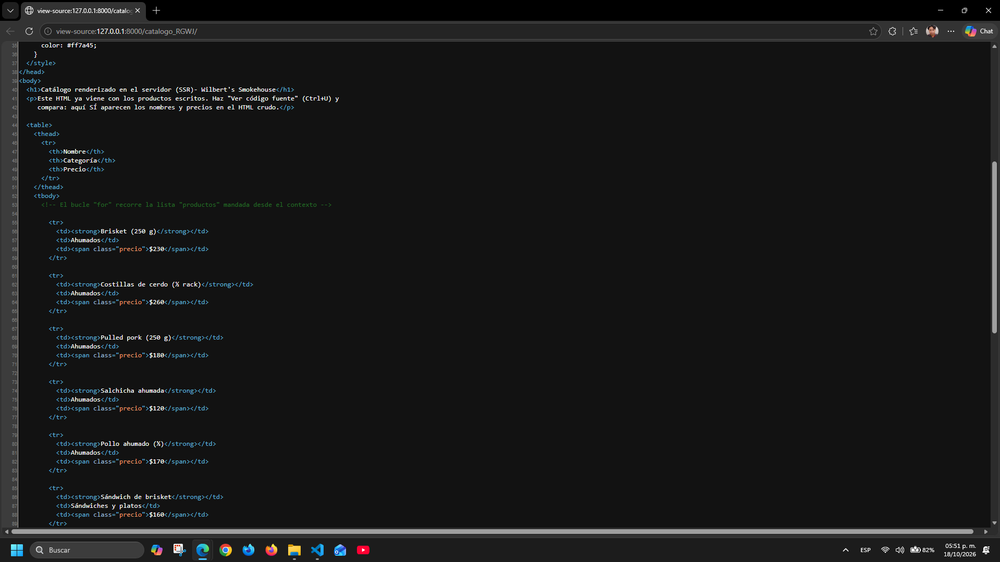
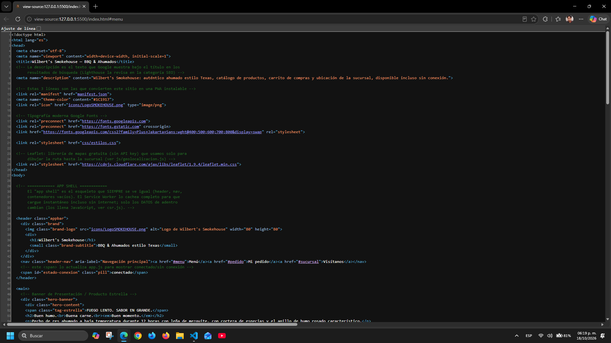
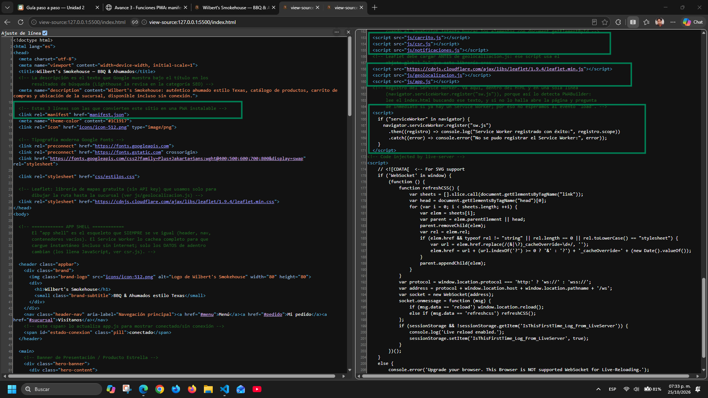
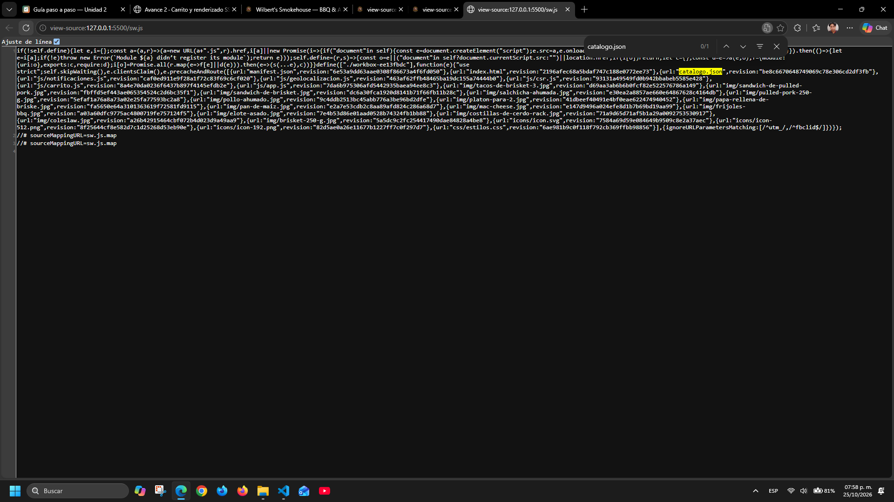
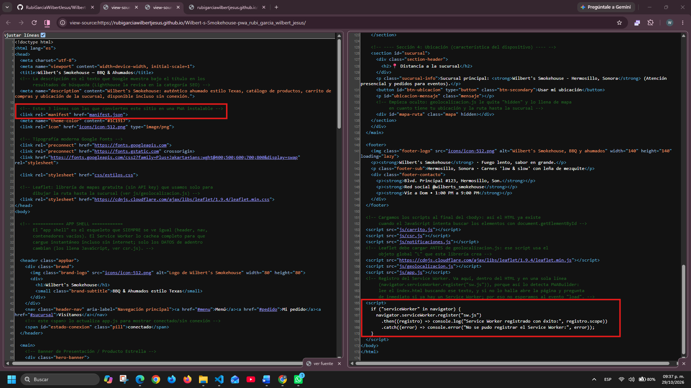
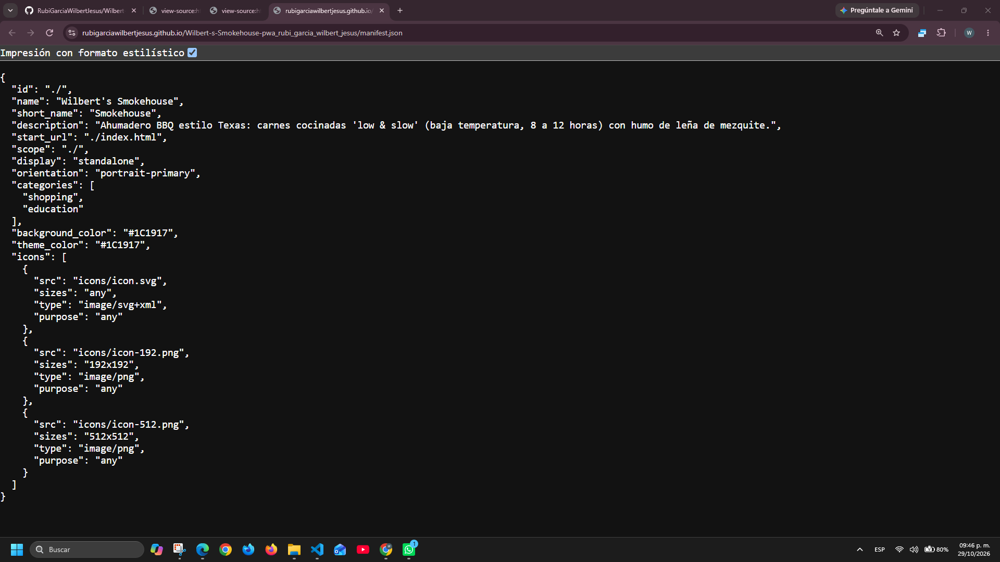
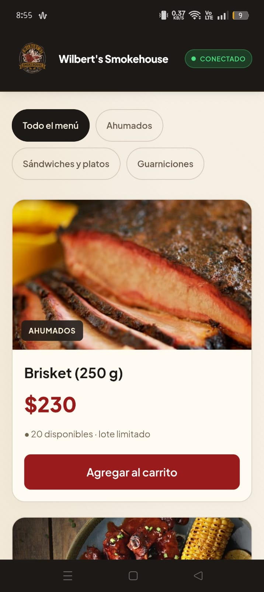

# Wilbert's Smokehouse — PWA de ventas

| Dato | Valor |
|---|---|
| **Alumno** | RUBI GARCIA WILBERT JESUS |
| **Grupo** | ING10-1 |
| **Negocio · giro** | Wilbert's Smokehouse · Ahumadero BBQ estilo Texas: carnes cocinadas 'low & slow' |
| **URL del repositorio** | https://github.com/RubiGarciaWilbertJesus/Wilbert-s-Smokehouse-pwa_rubi_garcia_wilbert_jesus |
| **URL de GitHub Pages** | https://rubigarciawilbertjesus.github.io/Wilbert-s-Smokehouse-pwa_rubi_garcia_wilbert_jesus/ |

## Historial de avances

| Avance | Hash del commit entregado | Fecha |
|---|---|---|
| 1 | f5f7a36  | 11/10/2026 |
| 2 | 17103a9 | 18/10/2026 |
| 3 | 6db8474 | 25/10/2026 |
| 4 | (se escribe en el reporte PDF) | 01/11/2026 |

## Comparación SSR vs CSR

### SSR (Django): los productos llegan escritos en el HTML

### CSR (JavaScript): el div del catálogo llega vacío

## Funciones PWA (avance 3)

### index.html: manifest y registro del Service Worker activos

### sw.js: Workbox precachea el catálogo y las fotos

## Versión publicada (avance 4)

### index.html en GitHub Pages

### manifest.json en GitHub Pages

### Mi app instalada en el celular

## Instalación en Android con Google Chrome

1. Abre **Google Chrome** en tu teléfono Android.
2. Visita [Wilbert’s Smokehouse](https://rubigarciawilbertjesus.github.io/Wilbert-s-Smokehouse-pwa_rubi_garcia_wilbert_jesus/).
3. Espera a que carguen el catálogo y las imágenes.
4. Si aparece una ventana que ofrece instalar la aplicación, pulsa **Instalar**.
5. Si no aparece, abre el menú de **tres puntos ⋮** de Chrome y selecciona **Instalar aplicación** o **Instalar y crear acceso directo → Instalar**, según tu versión de Chrome.
6. Confirma la instalación y espera a que termine.
7. Busca **Smokehouse** en el menú de aplicaciones o en la pantalla de inicio y abre la tienda.

### Uso sin conexión

Abre la aplicación con Internet y espera a que cargue el catálogo antes de desconectarte. Después podrás consultar los productos guardados y agregar artículos al carrito.

El carrito se conserva en el dispositivo. Al recuperar la conexión, la aplicación muestra un aviso de sincronización. **El envío del pedido es simulado.**

El mapa y las rutas por calles requieren conexión a Internet.

### Permisos opcionales

- **Notificaciones:** pulsa “Activar notificaciones” y concede el permiso para recibir avisos.
- **Ubicación:** pulsa “Usar mi ubicación” y concede el permiso para consultar la distancia y la ruta a la sucursal.

Estos permisos no son necesarios para instalar la aplicación.